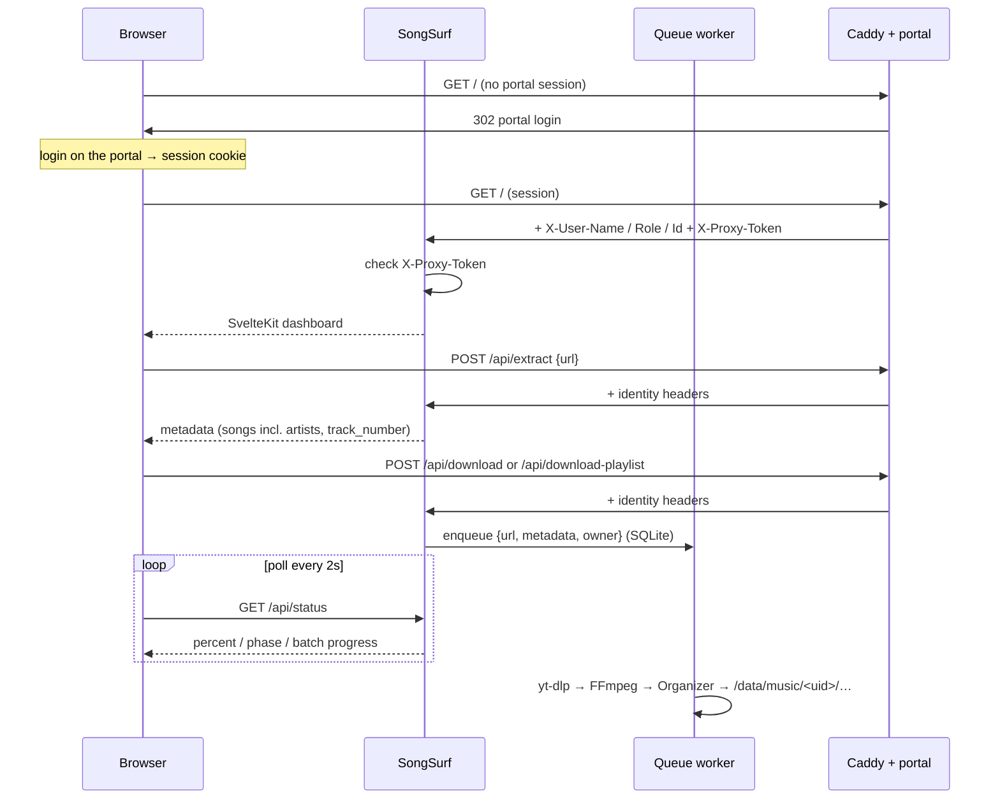
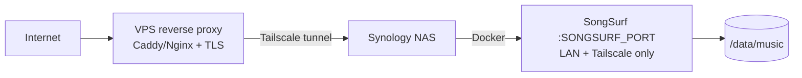

# Architecture — SongSurf

## System overview

SongSurf is a single, always-running Flask service behind the portal gate: Caddy (VPS) checks the portal session, then sends the identity with the proof `X-Proxy-Token`, which SongSurf verifies itself. It listens on `SONGSURF_PORT` (default 8081; production NAS uses 9000). The former Watcher proxy (on-demand start/stop) was removed in SSF-16.

```mermaid
graph TD
    User((Browser)) -->|portal session| C[Caddy forward_auth]
    Ext[Browser extension] -->|portal session| C
    C -->|X-User-* + X-Proxy-Token| SS[SongSurf :SONGSURF_PORT]
    SS --> YD[yt-dlp]
    YD --> FF[FFmpeg]
    FF --> ORG[Organizer]
    ORG --> MUSIC[/data/music/&lt;uid&gt;/<br/>Artist/Album/Title.mp3]
```

---

## Component breakdown

### SongSurf (`server/app.py`)

Always running (~40 MB RAM idle). Responsibilities:

- **Portal gate (AUTH-09)** — `_user_from_portal_headers()`: when `X-Proxy-Token` matches `SONGSURF_PROXY_SECRET` (constant-time compare), trusts the identity set by Caddy (`X-User-Name` → `sub`, `X-User-Role` lowercased, `X-User-Id` → `uid`, the storage key); otherwise → 401 JSON (API / extension) or a « passe par le portail » page (no login redirect: Caddy does it). A request without a valid portal UUID is refused. Empty secret → locked. `DEV_MODE=true` → local admin dev user.
- **CORS** — allows only the SongSurf Clip extension origin (fixed ID from the manifest `key`); `null` and other extensions are refused. `/logout` redirects to the portal.
- **Per-user storage** — keyed by the **portal UUID** (SSF-03), admin included: `/data/music/<uid>/` holds a `.owner` file with the pseudo for readability; cookies `/data/cookies/<uid>.txt`. On the NAS the admin library is the Jellyfin music folder mounted on `/data/music/<ADMIN_UID>`. `DEV_MODE` uses the same layout under `/data/music/dev-user-local/`.
- **Persistent state** (`server/state_store.py`, SQLite `/data/state/songsurf.db`) — download queue, round-robin pointer, daily counters, ZIP export state. Survives restarts: a song interrupted mid-download goes back to pending, a ZIP being built is reported as interrupted.
- **Download orchestration** — one worker thread takes songs one at a time, **round-robin between users** (each user's songs keep their order); max `MAX_PENDING_JOBS` (100) jobs per user; daily quota `DAILY_DOWNLOAD_LIMIT` per member, admin unlimited; batch progress for albums.
- **ZIP export** — built in a background thread (`/api/prepare-zip` → poll `/api/zip-status` → `/api/download-zip`); the member library is deleted after the download completes (temporary-library model). The admin library is permanent: never exported nor deleted (SSF-10 — no ZIP button for the admin, the API answers 403 `zip_disabled`; also refused on the music root and on any mount point).
- **Metadata editor API** — read/write any ID3 frame of a library file, upload covers.
- **Extension endpoints** — `/api/queue-direct` (extracts in a daemon thread then enqueues server-side), `/api/preview`, `/api/cookies/update`.

### Downloader (`server/downloader.py`)

Wraps yt-dlp:

- `extract_metadata(url)` — single video: title, artist (primary), **artists list**, album, album_artist, year, **track_number**, thumbnail candidates, duration. Rejects videos over `MAX_DURATION_SECONDS`.
- `extract_playlist_metadata(url)` — album/playlist via `extract_flat`: playlist title/artist/year/thumbnail + per-song `{title, artist, artists, url, id, duration, track_number}` (track number = `playlist_index` or position).
- `download(url, metadata)` — bestaudio → MP3 (FFmpeg, best VBR quality), staged in `/data/temp`, cached by filename (reuses an existing temp file).
- Artist normalization: yt-dlp `artists` list preferred; string fallback split on `&`, `,`, `et`, `and`, `/`; ` - Topic` suffix stripped. The primary artist (first) names the folder.
- Cookies: per user, `/data/cookies/<uid>.txt` (synced by the extension). Extraction and download use the job owner's file; without it the request is refused (`cookies_missing`).

### Organizer (`server/organizer.py`)

Post-download file management:

- Places files as `Artist/Album/Title.mp3` (primary artist folder), duplicate-safe with `(n)` suffixes. MP3 only.
- Featuring detection — `feat./ft./featuring` parsed out of the title, re-appended as `(feat. X)`, and featured artists added to the TPE1 list.
- ID3 tags (Mutagen): `TIT2`, `TPE1` **multi-value**, `TPE2` album artist (always set, single value — Jellyfin grouping key), `TALB`, `TDRC`, `TRCK` as `n/total`, `APIC` embedded cover.
- `cover.jpg` written into each album folder (thumbnail sidecar → embedded APIC → FFmpeg frame extraction fallbacks).

---

## Request lifecycle



---

## Threading model

| Thread | Where | Purpose |
|---|---|---|
| Main Flask | SongSurf | HTTP handling, validation, enqueue (album = one job) |
| Download worker | SongSurf | Claims the next song round-robin from SQLite (`store.claim_next`), processes it, removes it from the queue only once done; updates `download_status` under `queue_lock` |
| ZIP builder | SongSurf | One per export: writes `<zip>.part`, publishes progress, renames when done |
| queue-direct daemon | SongSurf | Per extension request: extracts metadata then enqueues server-side (fire-and-forget) |

In-memory state (`download_status`, `_last_*_by_user`) is guarded by `queue_lock`; persistent state (queue, quotas, ZIP) lives in `StateStore`, one SQLite connection behind its own lock (lock order: `queue_lock` → store, never the reverse). SongSurf is served by waitress (one process, several threads) and exit cleanly on SIGTERM (tini as PID 1 via `init: true`).

---

## Deployment topology



Compose overlays merged at runtime by `docker/compose-switch.sh` from `DEPLOY_TARGET`:

| File | Role |
|---|---|
| `docker-compose.yml` | Base — services, volumes, healthchecks |
| `docker-compose.local.yml` | Dev — publishes ports to localhost (bridge) |
| `docker-compose.nas.yml` | Prod — `network_mode: host` |

---

## Frontend architecture

SvelteKit (adapter-static) — static bundle built in the Docker multi-stage build (Node → Python image) and served by Flask (`/`, `/library`, `/metadata` and `/_app/*`; a reload on `/library` renders the app instead of a 404).

Mobile first, music-app style (SSF-13): two tabs « Ajouter » (`/`) and « Ma musique » (`/library`), bottom tab bar on phones, top bar on desktop (≥ 900 px).

```
frontend/src/
  routes/
    +layout.svelte         theme, /api/status polling, shell (top bar, tabs, mini bar, sheets)
    +page.svelte           Ajouter: paste a link, check the card, follow downloads
    library/+page.svelte   Ma musique: home / ?artist= / ?album= (stack navigation)
    metadata/+page.svelte  old address → redirects to /library
  lib/
    api.js                 fetch wrapper — all backend calls
    stores.js              user, downloadStatus, theme, toasts, confirmAction
    downloads.js           current song, queue, session history (done / failed + retry)
    library/               data.js (tree, todo, image versions, URLs) · actions.js (« ⋯ » menus,
                           uploads, admin deletions) · genres.js (genre cascade, English names)
    ui/sheets.js           bottom sheets + shallow history entry (phone Back closes the sheet)
    metadata/id3.js        ID3 labels / constants
    components/
      shell/               TopBar, TabBar, MiniBar
      add/                 AddForm, DownloadList
      library/             LibraryHome, ArtistView, CoverFlow, AlbumView, TrackRow
      sheets/              SheetHost, Account, Menu, TrackEdit, AlbumEdit, Move, FillWizard,
                           Recover (ZIP), Tool (expert tools)
      ui/                  Icon, Cover, Sheet, GenrePicker
      metadata/            expert tools kept from SSF-05: ArtistAudit, AlbumReorder,
                           ArtistGenre, SongDetails (styled by styles/metadata.css)
      Toast, ConfirmModal
    styles/                design-system.css (tokens), components.css, layouts.css, app.css, metadata.css
```

Svelte 5 (runes: `$state`, `$derived`, `$props`, `onclick`), SvelteKit 2, Vite 5, built with Node 22. `npm run check` runs `svelte-check`. Map of every screen/action/API route: `docs/FRONTEND_MAP.md`.

Key flows:

- **Queueing**: « Ajouter » submits straight to the server (the server owns ordering and drains album by album); « En cours » and the mini bar reflect it via `/api/status` polling. A finished song refreshes « Ma musique »; a failed one shows « Réessayer » (the server returns the URL in `last_error`).
- **Extension intake**: server-side fire-and-forget — the extension posts straight to `/api/queue-direct`, which extracts and enqueues without involving the page.
- **Expert mode = admin only** (SSF-13): numbering, iTunes audit, artist genre and deletions are hidden for members and refused by the API (403 `admin_only`). Members complete missing tags with the « À remplir » wizard.
- **State + image caching**: the library tree is cached in localStorage (`ssf.lib.tree`, stale-while-revalidate). Cover/artist image URLs carry a stable per-path version (`?t=<n>`, stored in `ssf.meta.imgv`) bumped only when a cover is uploaded — combined with the backend's `Cache-Control` headers, the browser serves all images from cache across navigations instead of re-downloading them.
- Design tokens come from the MyCss design system (CSS custom properties, light/dark via `html.dark`).

---

## Stack summary

| Layer | Technology |
|---|---|
| Backend | Python 3.11 + Flask |
| Download | yt-dlp (+ optional cookies from the extension) |
| Audio | FFmpeg (MP3, best VBR) |
| Tags | Mutagen (ID3v2.4, multi-value frames) |
| Images | Pillow (cover crop/resize → JPEG) |
| Frontend | Svelte 5 + SvelteKit 2, adapter-static |
| Containers | Docker Compose overlays (one service) |
| Auth | Portal gate (Caddy `forward_auth` + rev0auth), proof checked by SongSurf |
